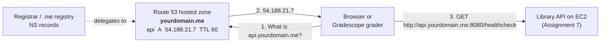

# Assignment 8: DNS for Your Library API

## Overview

Right now your Assignment 7 Library API lives at an address like `http://54.188.21.7:8080`. Using an IP address is hard to remember, and it changes every time your instance is replaced. In this assignment you give your API a real, and hopefully, more memorable name:

```text
http://api.<yourdomain>.me:8080
```

You will:

1. Register a new `.me` domain.
2. Create a Route 53 public hosted zone and point your domain's name servers at it.
3. Run your Assignment 7 server on EC2, using the Terraform you already have.
4. Create an `A` record for `api.<yourdomain>.me` on Route 53  that points to your server.

You do the DNS administration work in the AWS Console. No new code or Terraform is required.




## Learning Outcomes

By completing this assignment, you will be able to:

- Register a domain and explain the roles of the registry, the registrar, and you as the registrant
- Delegate a domain to a DNS provider by changing its name servers
- Create and manage a public hosted zone and records in Amazon Route 53
- Verify DNS delegation, records, and TTLs with `dig`
- Reach a cloud service by name instead of by IP address

## Prerequisites

- **Assignment 7** completed: your repo has `app/server.py` and `terraform/` with a committed `terraform.tfstate`
- **GitHub Student Developer Pack** (for the free `.me` domain). If your pack isn't approved yet, see [Appendix A](#appendix-a-other-registrars).
- Command-line tools: `dig` and `curl`. On Ubuntu: `sudo apt install dnsutils curl`
- AWS CLI and Terraform, set up as in earlier assignments
- Python 3.10 or newer (for the self-check script; no packages to install)

## Key Terms

| Term | Meaning |
|---|---|
| **Registrar** | The company you buy the domain from (e.g. Namecheap) |
| **Registry** | The organization that runs a TLD such as `.me` and its name servers |
| **Hosted zone** | Route 53's container for all the DNS records of one domain |
| **Name servers (NS)** | The servers that give the official answers for your domain. Route 53 assigns 4 to each hosted zone. |
| **Delegation** | Telling the registry, through your registrar, which name servers answer for your domain |
| **A record** | Maps a name to an IPv4 address |
| **TTL** | Time to Live: how many seconds resolvers may cache an answer |

---

## Part 1 Register Your Domain

1. Claim your Student Developer Pack offer from Namecheap and register a unique `.me` domain. A short name made from your own name works well, e.g. `dfannin.me`.
   - Use plain ASCII letters, digits, and hyphens only (no internationalized/IDN names).
   - Keep privacy protection (domain privacy) turned on. It's free.
   - **Turn auto-renew off**, so you aren't charged after the free year.
2. Put your domain on the first line of `domain.txt` in this repository:

   ```text
   dfannin.me
   ```

## Part 2 Create the Route 53 Hosted Zone and Delegate to It

### 2.1 Create the hosted zone

1. In the AWS Console, open **Route 53 → Hosted zones → Create hosted zone**.
2. **Domain name:** your domain, e.g. `dfannin.me`. **Type:** *Public hosted zone*. Click **Create hosted zone**.
3. Open the zone and find its **NS** record. It lists 4 name servers that look like this (yours will differ):

   ```
   ns-476.awsdns-59.com.
   ns-712.awsdns-25.net.
   ns-1139.awsdns-14.org.
   ns-1772.awsdns-29.co.uk.
   ```

> **Create the hosted zone only once.** If you delete it and create a new one, the new zone gets *different* name servers, and you'll have to update your registrar again.

### 2.2 Point your domain at Route 53

1. In Namecheap, open **Domain List → Manage** for your domain.
2. Under **Nameservers**, choose **Custom DNS**.
3. Enter the 4 Route 53 name servers. Leave off the trailing dots. Click the green check mark to save.

### 2.3 Wait, then verify

The change usually appears within an hour, but it can take longer. Check it from your laptop:

```bash
dig +short NS <domain>.me
```

When the 4 `awsdns` name servers come back, the delegation is working. If you still see `registrar-servers.com` names, wait and try again.

## Part 3: Run Your Library API

Create your Assignment 8 repository by using the `Use Template` button: [neu-csye6225-sea/202609-assignment-08-template](https://github.com/neu-csye6225-sea/202609-assignment-08-template.git).  You'll reuse your server app code and Terraform templates from Assignment 7.

1. Copy `app/` and `terraform/` from your Assignment 7 repository into this repo. Copy the `terraform/terraform.tfstate` as well.:

   ```bash
   # from the root of this (Assignment 8) repository
   cp -r ../<your-assignment-7-repo>/app ./
   cp -r ../<your-assignment-7-repo>/terraform ./
   ```

2. **If your Assignment 7 server is still running**, you're done with this part. The state file you copied already describes it.

   **If you destroyed it**, deploy it again:

   ```bash
   cd terraform
   terraform init
   terraform apply
   ```

3. Get your server's public IP and check that it's up:

   ```bash
   cd terraform
   terraform output -raw instance_public_ip
   curl "$(terraform output -raw api_base_url)/healthcheck"
   # {"status": "ok"}
   ```

> **From now on, run Terraform only from this repository.**

## Part 4: Create the `api` Record

In **Route 53 → Hosted zones → your domain → Create record**:

| Setting | Value |
|---|---|
| **Record name** | `api` (the console shows `api.<domain>.me`) |
| **Record type** | `A` |
| **Value** | Your instance's public IP from Part 3 |
| **TTL (seconds)** | `60` |
| **Routing policy** | Simple routing |

Click **Create records**, then verify it from your laptop:

```bash
# Ask a Route 53 name server directly (replace with one of your zone's NS values)
dig api.<domain>.me A @ns-476.awsdns-59.com +noall +answer
# api.jdoe-csye.me.   60   IN   A   54.188.21.7

# Through your normal resolver
dig +short api.<domain>.me

# Your API, by name
curl http://api.<domain>.me:8080/healthcheck
```

> **If your instance is ever replaced** (for example, `terraform apply` after editing `server.py`, or `destroy` followed by `apply`), it gets a **new public IP**. Edit the `api` record with the new IP and commit the new `terraform.tfstate`. The autograder checks that your record and your state file agree.


## Part 5: Check and Submit

### 5.1 Run the self-check

This script runs **the same checks as the Gradescope autograder**:

```bash
python3 scripts/check_submission.py
```

Fix anything marked `FAIL` and run it again. Each failure message says what to do.

### 5.2 Commit and push

Your repository must contain:

```
domain.txt                  # your domain on the first line
app/server.py               # from Assignment 7
terraform/                  # from Assignment 7, including terraform.tfstate
scripts/check_submission.py
```

```bash
git add domain.txt app terraform
git commit -m "Assignment 8: DNS for the Library API"
git push origin main
```

### 5.3 Submit on Gradescope

1. Open **https://www.gradescope.com** directly in your browser. Don't use the Gradescope page inside Canvas, because GitHub sign-in doesn't work there.
2. Open **Assignment 8**, choose **GitHub**, and select this repository and the `main` branch.
3. Review your score. You can resubmit as many times as you like before the deadline.

> **You can do a `terraform destroy` when your submission passes, you do not need to keep your server running.   It is also safe to keep your domain in Route 53 and keep the current entries. You will modify them for future lessions. 

---

## Grading (20 points)

| # | Check | Points |
|---|---|---|
| 1 | `domain.txt` names your domain | 1 |
| 2 | `terraform/terraform.tfstate` contains your instance's public IP | 1 |
| 3 | The `.me` registry delegates your domain to Route 53 name servers | 4 |
| 4 | Your Route 53 hosted zone answers authoritatively for the domain | 2 |
| 5 | An `A` record exists for `api.<yourdomain>.me` | 3 |
| 6 | The `api` record's TTL is 60 seconds | 1 |
| 7 | The `api` record points to the instance in your `terraform.tfstate` (and only to it) | 3 |
| 8 | `GET http://api.<yourdomain>.me:8080/healthcheck` returns `200 {"status": "ok"}` | 3 |
| 9 | The grader can log in and `GET /v1/books` through `api.<yourdomain>.me` | 2 |
| | **Total** | **20** |


## Troubleshooting

| Symptom | Fix |
|---|---|
| `dig NS` still shows `registrar-servers.com` | The name server change hasn't taken effect yet, or wasn't saved. Recheck **Custom DNS** in Namecheap, then wait. |
| Check 4 fails with `REFUSED` | The name servers at your registrar don't match your hosted zone. This happens if you re-created the zone. Copy the zone's current 4 NS values to Namecheap. |
| `dig` for `api.` returns nothing, but the record exists | Your resolver cached the "doesn't exist" answer from before you created it. Query a Route 53 server directly with `@ns-...`, or wait a few minutes. |
| Check 7: the record points to a different IP than the state | Your instance was replaced. Update the `api` record with `terraform output -raw instance_public_ip` and commit `terraform.tfstate`. |
| Check 8: connection refused or timed out | The instance is stopped or still booting, or the server isn't running. Check with `curl` against the IP. Remember the `:8080`. |
| Check 9: login fails | Your server must accept the fixed grader account from Assignment 7 (`grader` / `Library-Fall2026`). |
| Gradescope says "GitHub refused to connect" | You opened Gradescope inside Canvas. Go to gradescope.com directly. |


## Appendix A: Other Registrars

Namecheap's `.me` offer comes with the GitHub Student Developer Pack. If your pack hasn't been approved yet (approval can take several days), you can register a domain elsewhere. Any registrar and any TLD works with the autograder. Choose one that:

- lets you set **custom name servers**,
- includes **free privacy protection**, and
- lets you **turn off auto-renew**.

Options include Porkbun, Spaceship, and Amazon Route 53 Domains. (Cloudflare Registrar won't work, because it requires Cloudflare's own name servers.) If you register through Route 53 Domains, it creates the hosted zone and sets the name servers for you, so Part 2 is done automatically. Prices vary widely by TLD, so check the renewal price before you buy.
